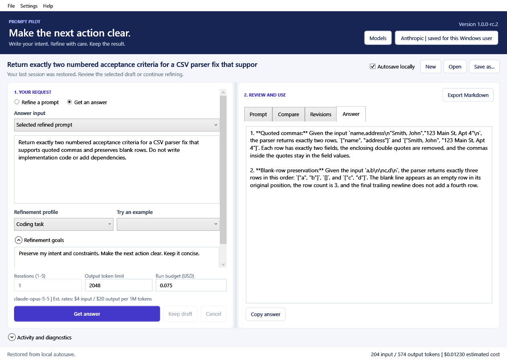

# Prompt Pilot documentation

Current product documentation for **1.0.0-rc.2**:

- [Start, configure a provider and use a complete session](../README.md).
- [Workflow walkthrough](workflow.md).
- [Validation record and remaining proof boundaries](VALIDATION.md).
- [Model discovery and recommendation policy](MODEL-MANAGEMENT.md).
- [Privacy and local data](PRIVACY.md).
- [Release and support instructions](RELEASE.md).
- [Developing, testing and building from source](DEVELOPMENT.md).
- [Release roadmap](../ROADMAP.md).

`example-session.png` shows the real desktop app using a synthetic acceptance
session. It is not evidence of clean-machine or beta acceptance.

## Current product demos

[index.html](index.html) introduces the current release candidate; [demo.html](demo.html)
is an interactive, offline illustration of its Refine / Review / Answer workflow
and recorded model decisions. All workflow text is curated synthetic sample content,
not a runtime provider response. It collects no API keys and makes no generation requests.
The screenshots show the actual desktop app. The demo also states the dated validation
and open release gates.

[demo.svg](demo.svg) remains a historical concept illustration and is not linked from
the current presentation. It does not describe the current workflow.

The portable portfolio edition is generated with `python3 tools/Sync-PortfolioDemo.py`
into ignored `build/portfolio-demo/`. Copy that folder's assets into the portfolio's
`public/demos/PromptPilot/`. Both editions share the same CSS, JavaScript and samples.
See [DEMO.md](DEMO.md) for provenance and maintenance.
